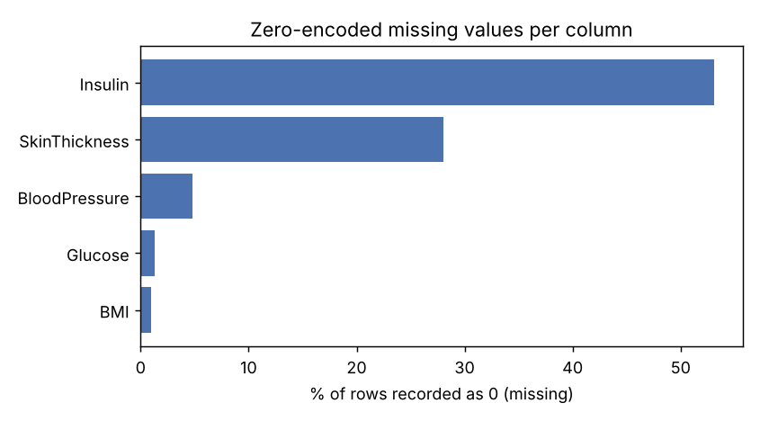
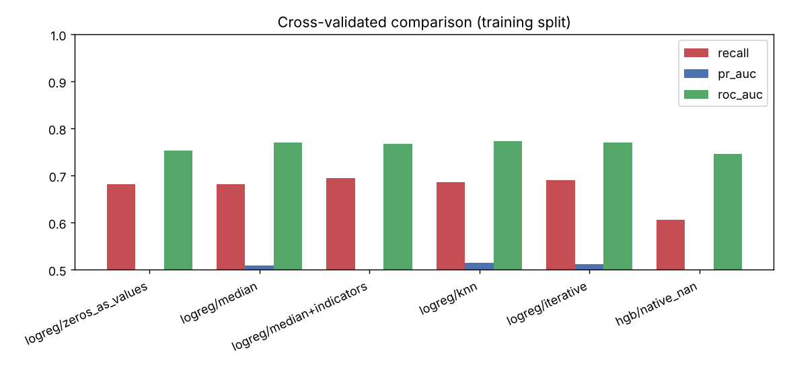
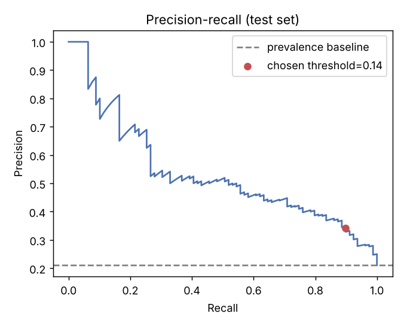
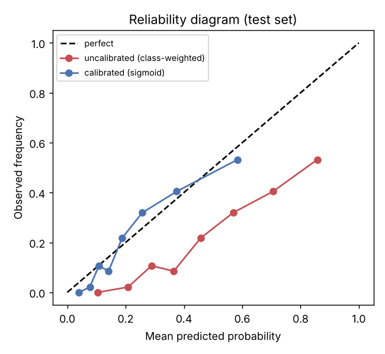
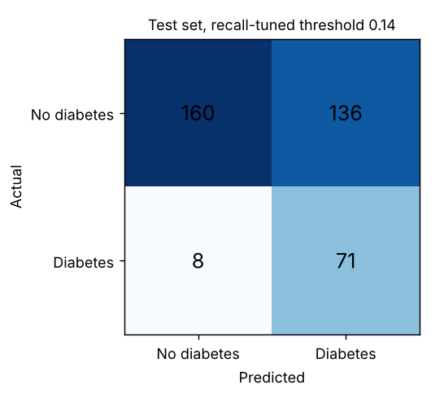
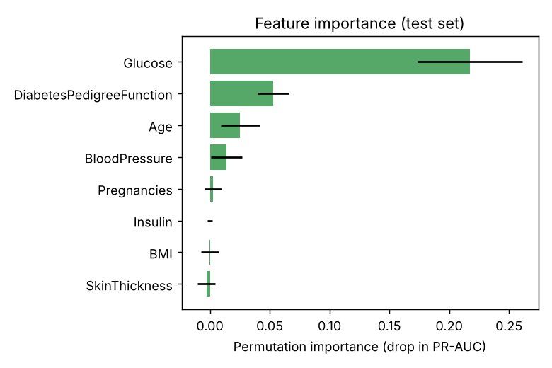

# Diabetes Risk Prediction with Zero-Encoded Missing Data

Compares imputation strategies on a Pima-style tabular dataset, then builds a calibrated, recall-focused risk classifier.

> **Not for clinical use.** The data are synthetic and the model is a demonstration. It must not inform diagnosis or treatment.

## Problem statement

In the classic Pima Indians diabetes data, "not measured" is stored as `0` in columns where zero is physiologically impossible (glucose, blood pressure, skin thickness, insulin, BMI). Treating those zeros as real values distorts models. This project asks: how much does the imputation strategy matter, and how can a screening-style classifier be tuned for high recall while keeping its probabilities calibrated?

## Highlights

All numbers come from `reports/metrics.json` (375-row held-out test set, 21% prevalence).

- Selected model: `logreg/knn` (class-weighted logistic regression with KNN imputation), chosen on cross-validated PR-AUC over the training split only.
- Test ROC-AUC 0.807, PR-AUC 0.537 (prevalence baseline PR-AUC 0.210).
- Recall-tuned threshold 0.144 (target recall 0.85, picked on out-of-fold training predictions): test recall 0.899, precision 0.343, specificity 0.541 (TP 71, FP 136, TN 160, FN 8).
- Calibration (sigmoid): ECE 0.234 -> 0.050 and Brier 0.192 -> 0.133 versus the uncalibrated class-weighted model.
- Imputation strategies differ by at most about 0.025 CV PR-AUC, which is within the fold-to-fold standard deviation (0.03-0.06). No strategy is clearly better on this data.

## Data

**Fully synthetic**, generated by a seeded script (`src/diabetes_risk/data.py`); it is not real patient data. Features follow the Pima schema (Pregnancies, Glucose, BloodPressure, SkinThickness, Insulin, BMI, DiabetesPedigreeFunction, Age) with correlations between them. Outcome is drawn from a logistic model with noise. Zeros are then injected to mimic missing measurements, partly dependent on other values (insulin is more often missing at low glucose, skin thickness at low BMI).

Zero-encoded missing rate: Insulin 53.1%, SkinThickness 28.0%, BloodPressure 4.8%, Glucose 1.3%, BMI 0.9%. 1,500 rows; the committed sample is `data/diabetes_sample.csv`.

## Project structure

```
config.yaml            seed, split, CV, target recall
data/                  committed synthetic sample CSV
src/diabetes_risk/     data.py, features.py (imputers, pipelines), train.py, evaluate.py, predict.py
scripts/run_pipeline.py  data -> compare -> calibrate -> evaluate -> save
reports/               metrics.json, figures/
models/                saved joblib bundle (git-ignored)
tests/                 unittest suite
```

## Quickstart

```bash
pip install -r requirements.txt
python scripts/run_pipeline.py          # about 1.5 minutes on CPU
python -m unittest discover -s tests -v
python -m src.diabetes_risk.predict --json '{"Glucose": 148, "BMI": 33.6, "Age": 50}'
```

`make install | data | train | test | run` are equivalent shortcuts.

## Methodology

1. Stratified 75/25 train/test split; the test set is untouched until final evaluation.
2. Candidates evaluated with 5-fold stratified CV on the training split: prior-probability baseline, logistic regression with five treatments of the zeros (zeros as values, median, median plus missing indicators, KNN, iterative/MICE-style), and histogram gradient boosting using native NaN handling. Imputers sit inside the pipeline, so they are fit only on training folds (no leakage).
3. The best non-baseline model by CV PR-AUC is selected.
4. Probabilities are calibrated with sigmoid (Platt) calibration using internal CV.
5. The decision threshold is the highest one reaching 85% recall on out-of-fold training predictions, then applied once to the test set.
6. Permutation importance (PR-AUC drop) on the test set.

## Results

Cross-validated, training split (mean of 5 folds, threshold 0.5 for recall/precision):

| Model | Recall | Precision | PR-AUC | ROC-AUC |
|---|---|---|---|---|
| baseline/prior | 0.000 | 0.000 | 0.210 | 0.500 |
| logreg/zeros_as_values | 0.682 | 0.387 | 0.498 | 0.754 |
| logreg/median | 0.682 | 0.384 | 0.509 | 0.771 |
| logreg/median+indicators | 0.695 | 0.382 | 0.499 | 0.768 |
| logreg/knn | 0.686 | 0.392 | 0.514 | 0.774 |
| logreg/iterative | 0.691 | 0.389 | 0.511 | 0.771 |
| hgb/native_nan | 0.606 | 0.377 | 0.490 | 0.746 |

Held-out test set, selected model:

| Setting | Recall | Precision | F1 | Specificity | Brier | ECE |
|---|---|---|---|---|---|---|
| Uncalibrated, threshold 0.5 | 0.759 | 0.414 | 0.536 | 0.713 | 0.192 | 0.234 |
| Calibrated, threshold 0.5 | 0.266 | 0.525 | 0.353 | 0.936 | 0.133 | 0.050 |
| Calibrated, threshold 0.144 (recall-tuned) | 0.899 | 0.343 | 0.497 | 0.541 | 0.133 | 0.050 |

Calibration removes the class-weight inflation of probabilities, so a 0.5 cutoff on calibrated output misses most positives; the threshold must be chosen for the recall goal. Glucose dominates permutation importance (0.217 PR-AUC drop), followed by pedigree function (0.053) and age (0.025).








## Limitations and future work

- Data are synthetic; results say nothing about real patients, and the imputation ranking depends on how missingness was simulated.
- Imputation differences are within CV noise on a 1,125-row training set; repeated CV or more data would be needed to rank them.
- The recall-tuned operating point trades specificity (0.541) for recall; a real deployment would need cost-based threshold selection.
- Single split, no subgroup or fairness analysis, no external validation.
- Future work: repeated CV with significance tests, MNAR-aware models, decision-curve analysis.

## Using a real dataset

Use the Pima Indians Diabetes Database (UCI / Kaggle "Pima Indians Diabetes Database", `diabetes.csv`). Its columns already match: Pregnancies, Glucose, BloodPressure, SkinThickness, Insulin, BMI, DiabetesPedigreeFunction, Age, Outcome. Save it as `data/diabetes_sample.csv` (replacing the synthetic file) and rerun the pipeline; the zero-to-missing handling applies unchanged. Delete `reports/` outputs and the old model first.

## License

MIT, see `LICENSE`.
